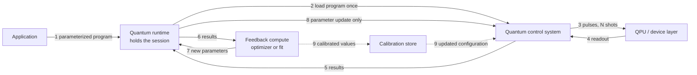
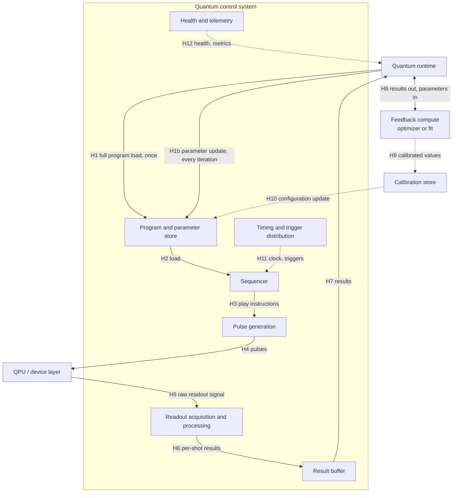

# UC-04 — Iterative calibration and adaptive execution

> **Seed draft.** The chair prepared this as a starting point for Meeting 03. Numbers are order-of-magnitude estimates to be confirmed or corrected by the owner and control expert. Every estimate is marked as such in its Source column.

| Field | Value |
|---|---|
| Status | Draft (seed for Meeting 03) |
| WG relevance | Primary |
| Timing regime | Near-time (between programs in a session) — term pending System Architecture WG alignment |
| Fault-tolerance assumption | Hybrid, no full fault tolerance (also needed under FTQC for calibration) |
| Qubit modality | Modality-agnostic |
| Owner (Part A) |  |
| Control expert (Part B) | TBD |
| Reviewer | TBD |
| Last updated | 2026-10-20 |

---

# Part A — The scenario

## A1. Scenario

A researcher runs a loop in which each round of quantum results decides what the next round does. Two common forms:

- **Variational algorithms** (e.g. VQE, QAOA). A classical optimizer proposes circuit parameters, the QPU runs the circuit for a few thousand shots, and the optimizer uses the results to propose the next parameters. This repeats hundreds to thousands of times.
- **Calibration.** The system sweeps a pulse parameter (amplitude, frequency, duration), fits the response, and writes the best value back into the device configuration. Calibration runs both on a schedule and whenever the device drifts.

In both cases the program structure stays the same between iterations; only a handful of numbers change.

## A2. Why it matters

- Variational and calibration loops are the main way current hardware is used, and calibration stays necessary on fault-tolerant machines.
- If every iteration needs a full recompile and re-upload, the QPU sits idle most of the time. Classical overhead between iterations, not quantum execution, often dominates wall-clock time.
- Calibration results must flow back into the control system's configuration. Who owns that configuration, and how it's updated, is an interoperability question.

## A3. What this use case adds

- [x] A timing requirement no other use case has: per-iteration turnaround between programs, not within a shot
- [x] A distinct data-movement pattern or data volume: results go out and small parameter sets come back, every iteration; calibration may move raw readout traces
- [ ] A distinct scheduling or co-allocation need
- [ ] A synchronization need across components or QPUs
- [x] An instruction-safety need: calibration sweeps deliberately push pulse parameters, so limits must be enforced
- [ ] A scale need
- [x] An interface boundary the other use cases miss: updating parameters and device configuration without recompiling (links to the candidate compiler interface IF-K)

**Most distinctive:** the program stays loaded and only its parameters change, so the cost of the parameter-update path decides how efficiently the QPU is used.

## A4. Scope checks

- [x] Runs on-premises
- [x] Any real-time feedback or decoding compute sits next to the QPU (the optimizer isn't real-time, but co-locating it cuts round-trip time)
- [x] If more than one QPU is involved, the control stack manages entanglement between them (single QPU)

## A5. Actors and logical components

| Logical role | Plain-language description | Involved? | What it does in this use case |
|---|---|---|---|
| Application | The user's program or algorithm | Yes | Defines the parameterized circuit or calibration experiment and the stopping criterion |
| Workflow / orchestration | Coordinates steps across CPU, GPU, and QPU tasks | ? | May drive the outer loop; context only |
| HPC resource manager | Allocates classical nodes (e.g. Slurm) | ? | Allocates the node running the optimizer; context only |
| Quantum resource manager | Allocates and tracks QPU access | Yes | Reserves the QPU for the whole session so iterations don't re-queue |
| Quantum runtime | Runs quantum programs and manages sessions | Yes | Holds the session, binds new parameters, returns results |
| Quantum control system | Electronics that turn programs into pulses and readout signals into data | Yes | Executes shots and applies parameter or configuration updates |
| QPU / device layer | The qubits and their immediate hardware | Yes | Runs the circuits |
| Feedback compute | CPU, GPU, or FPGA processing results during execution | Yes | Runs the optimizer or the calibration fit |
| QEC decoder | Turns error syndromes into corrections | No | — |
| Other: calibration store | Holds current device parameters | ? | Receives calibration results; ownership unclear (see C4) |

## A6. Trigger and preconditions

**What starts it?** The user submits a variational job, or a calibration is triggered by schedule, drift detection, or an operator.

**What must already be true?** A QPU session is reserved. The parameterized program is compiled and loaded once. Initial parameters and the device configuration are available.

## A7. Nominal flow

1. The application submits the parameterized program and initial parameters to the runtime.
2. The runtime loads the program into the control system once.
3. The control system runs N shots on the QPU.
4. The QPU returns readout signals to the control system.
5. The control system returns results (bitstrings, averages, or raw traces) to the runtime.
6. The runtime passes results to feedback compute.
7. Feedback compute (optimizer or fit) returns new parameters to the runtime.
8. The runtime sends only the new parameters to the control system. Steps 3–8 repeat until convergence.
9. For calibration: the final values are written to the device configuration, and the application receives the result.

## A8. Information flow, Level 1

## A9. How fast does it need to be?

- [ ] Inside the same shot
- [ ] Between shots of the same program
- [x] Between programs in the same session
- [ ] Between separate jobs, or later
- [ ] Not sure

**Rough deadline:** 1 ms–1 s per iteration (estimate). This is a soft deadline: missing it costs QPU utilization, not correctness.

**What sets that deadline?** The time the QPU spends executing each iteration's shots. Classical overhead per iteration should be small compared with it. For calibration, the whole procedure must finish well within the device's drift timescale (minutes to hours, modality dependent).

---

# Part B — Inside the control stack

## B1. Information flow, Level 2

The straw-man decoder path is removed. The parameter-update path (H1b) is shown separately from the full program load (H1), because the gap between the two is the core of this use case. A result buffer is added between readout and the runtime.

## B2. Boundary crossings

| Hop | From → To | Interface | What crosses | Size × rate | Latency | Status | Source |
|---|---|---|---|---|---|---|---|
| H1 | Runtime → Program store | IF-E | Compiled program (waveforms, sequences) | kB–MB, once per session | 1 ms–1 s | TBD | Estimate (chair draft) |
| H1b | Runtime → Program store | IF-E | Parameter values only (tens to hundreds of numbers) | < 1 kB per iteration | Target 1 µs–1 ms | TBD | Estimate (chair draft) |
| H2 | Program store → Sequencer | Internal | Program and bound parameters | — | Unknown | TBD | |
| H3 | Sequencer → Pulse generation | Internal | Play instructions | — | Unknown | TBD | |
| H4 | Pulse generation → QPU | IF-H (landscape only) | Control pulses | — | — | TBD | |
| H5 | QPU → Readout acquisition | IF-H (landscape only) | Raw readout signal | — | — | TBD | |
| H6 | Readout acquisition → Result buffer | Internal | Per-shot outcomes or integrated values | ~1 bit per qubit per shot (bitstrings); more for IQ points or traces | Unknown | TBD | Estimate (chair draft) |
| H7 | Result buffer → Runtime | IF-E | Results for N shots: bitstrings, averages, or raw traces | Bitstrings: ~N × qubits bits (e.g. 10³ shots × 100 qubits ≈ 12.5 kB). Raw traces for calibration can be MB. | 1 ms–1 s | TBD | Estimate (chair draft) |
| H8 | Runtime ↔ Feedback compute | IF-F | Results out; new parameters back | As H7 out, < 1 kB back | 1 ms–1 s including optimizer time | TBD | Estimate (chair draft) |
| H9 | Feedback compute → Calibration store | Unclear (see C4) | Fitted calibration values | < 1 kB per calibration | > 1 s acceptable | TBD | Estimate (chair draft) |
| H10 | Calibration store → Program store | IF-E | Updated device configuration | kB | > 1 s acceptable | TBD | Estimate (chair draft) |
| H11 | Timing distribution → modules | IF-J | Clock, triggers | — | — | TBD | |
| H12 | Telemetry → Runtime | IF-I | Health, per-iteration timing breakdown | Small | > 1 s | TBD | |

## B3. Critical loops

| Loop | Hops | Deadline | What sets the deadline | Current estimate | Status |
|---|---|---|---|---|---|
| L1 Iteration turnaround (classical overhead only) | H7 → H8 → H1b → H2 | Small compared with shot execution time per iteration | QPU utilization | Unknown; reported anecdotally as ms to s, dominated by recompilation and upload when parameters can't be updated in place | TBD |
| L2 Calibration cycle | Full sweep → H9 → H10 | Well within device drift timescale | Drift of qubit parameters | Unknown | TBD |

## B4. Requirements drivers

| Dimension | Draft requirement | Status | Evidence |
|---|---|---|---|
| Latency | Per-iteration classical overhead (L1) should be small compared with per-iteration execution time | TBD | Needs measurement (C3) |
| Jitter | Not critical; turnaround variance only affects utilization | TBD | |
| Bandwidth / data volume | kB per iteration for bitstrings; MB if raw traces are returned for calibration | TBD | Estimate |
| Program size | Program loaded once; parameter updates must not require re-sending it | TBD | |
| Synchronization | None beyond normal shot timing | TBD | |
| Determinism | Not required across iterations | TBD | |
| Scale (qubits, QPUs, concurrent sessions) | Session must hold the QPU across 10²–10⁴ iterations without re-queuing | TBD | Estimate |
| Instruction safety | Parameter updates must be range-checked against device limits (amplitude, frequency, duty cycle), since calibration deliberately explores the parameter space | TBD | Meeting 1 (Matthias) |
| Failure behavior | A failed iteration should be reportable and retryable without losing the session | TBD | |
| Observability / telemetry | Per-iteration breakdown of time spent in compile, upload, execute, return, optimize | TBD | Needed to locate the bottleneck (Meeting 1, Santiago) |

## B5. Interfaces exercised

| Interface | Boundary | Used? | Role in this use case |
|---|---|---|---|
| IF-A | Application ↔ Workflow/orchestration | Context | Outer loop may live in a workflow |
| IF-B | Workflow/orchestration ↔ HPC resource manager | Context | — |
| IF-C | HPC resource manager ↔ Quantum resource manager | Context | Co-allocate optimizer node and QPU session |
| IF-D | Quantum resource manager ↔ Quantum runtime | Yes | Session held across iterations |
| IF-E | Quantum runtime ↔ Control system | **Yes, central** | Program load once (H1), parameter updates (H1b), results (H7), configuration updates (H10) |
| IF-F | Classical accelerator ↔ Quantum runtime | **Yes, central** | Results to optimizer, parameters back (H8) |
| IF-G | Classical accelerator ↔ Control system | Alternative | If the optimizer runs on or next to the control box, H7/H8 may bypass the runtime |
| IF-H | Control system ↔ QPU/device layer | Landscape | — |
| IF-I | Telemetry/observability across layers | Yes | Per-iteration timing breakdown |
| IF-J | Time and synchronization across layers | Minor | — |
| IF-K (candidate) | Compiler/toolchain ↔ runtime/control system | **Yes** | Parameterized or partially compiled programs avoid recompilation each iteration (Meeting 1, Daniel W.) |

## B6. Failure and edge cases

- **Recompilation fallback.** If a parameter change can't be bound in place (e.g. it changes pulse duration or the circuit structure), the system must recompile. Which changes force a recompile is an interoperability question (C2).
- **Out-of-range parameters.** An optimizer or sweep proposes values outside device limits. They should be rejected with a clear error rather than clipped silently.
- **Drift mid-loop.** The device drifts during a long variational run. Does the loop pause for recalibration, and who decides?
- **Session loss.** If the session is pre-empted, can the loop resume from the last parameters?

---

# Part C — Open items

## C1. Questions for a control expert or vendor

| Question | Section | Asked to | Answer | Status |
|---|---|---|---|---|
| Which parameters can be updated in place without recompiling (amplitude, phase, frequency, duration, circuit structure)? | B2 H1b | Control vendors | | Open |
| What is the typical latency of an in-place parameter update vs. a full program upload? | B3 L1 | Control vendors | | Open |
| Do results come back as bitstrings, averaged values, or raw traces, and who decides? | B2 H7 | Control vendors | | Open |
| Where is the calibration store today: in the control system, the runtime, or a separate service? | A5, C4 | Control vendors, facilities | | Open |
| Can the optimizer run on or next to the control box, skipping the runtime round trip? | B5 IF-G | Control vendors | | Open |

## C2. Interoperability questions

- Is there a vendor-neutral way to express a parameterized program and a parameter update?
- Which parameter changes are guaranteed not to require recompilation?
- Is there a common format for calibration results and device configuration?

## C3. Evidence required

- Measured breakdown of per-iteration time (compile, upload, execute, return, optimize) on at least two control stacks.
- Typical shot counts and iteration counts for representative variational and calibration workloads.

## C4. Open decisions

| Decision | Options | Owner | Needed by |
|---|---|---|---|
| Are calibration and variational algorithms one card or two? | One card (current) / split | Group | Meeting 03 |
| Who owns the calibration store, and which interface updates it? | Control system / runtime / separate service | Group | Meeting 03 |
| Is IF-K (compiler interface) needed to describe parameter binding? | Yes / covered by IF-E | Group | Meeting 03 |
