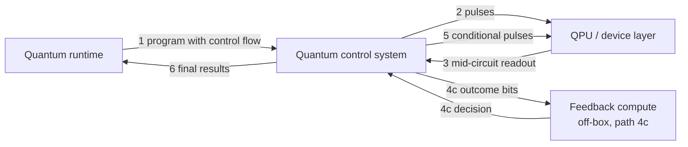
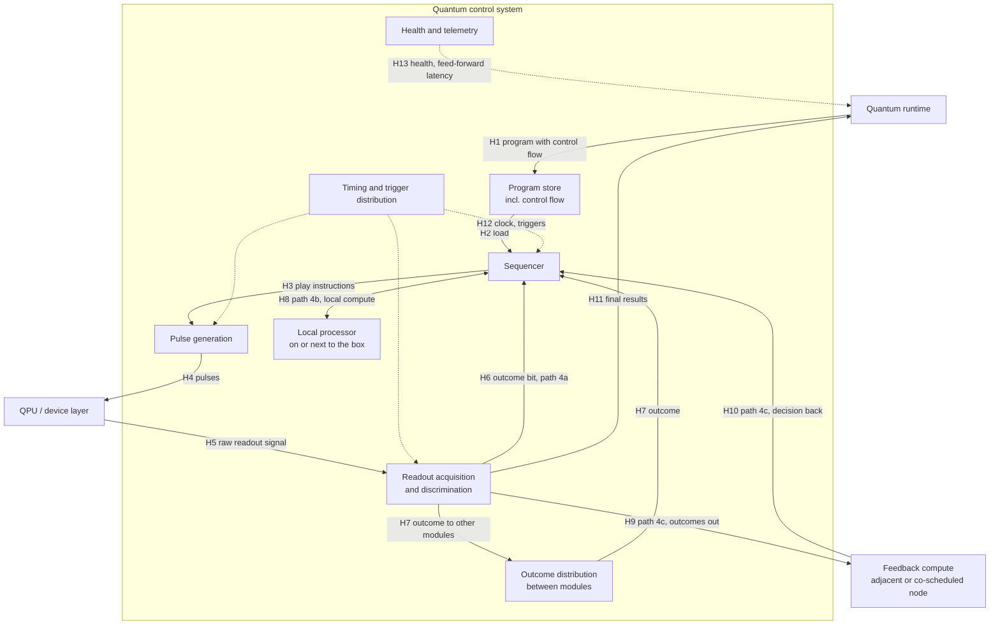

# UC-05 — Mid-circuit measurement and feed-forward

> **Seed draft.** The chair prepared this as a starting point for Meeting 03. Numbers are order-of-magnitude estimates to be confirmed or corrected by the owner and control expert. Every estimate is marked as such in its Source column.

| Field | Value |
|---|---|
| Status | Draft (seed for Meeting 03) |
| WG relevance | Primary |
| Timing regime | Real-time (within a shot) — term pending System Architecture WG alignment |
| Fault-tolerance assumption | Either. Runs on current hardware; also a building block for FTQC |
| Qubit modality | Modality-agnostic. Deadlines scale with each modality's coherence and measurement times |
| Owner (Part A) |  |
| Control expert (Part B) | TBD |
| Reviewer | TBD |
| Last updated | 2026-10-20 |

---

# Part A — The scenario

## A1. Scenario

A program measures some qubits partway through a circuit and uses the outcome to decide what to do next, while the other qubits are still holding quantum information. Examples:

- **Active reset:** measure a qubit and flip it back to |0⟩ if needed, instead of waiting for it to relax.
- **Teleportation-based operations:** measure two qubits and apply a correction to a third depending on the two outcomes.
- **Repeat-until-success:** try an operation, measure to check whether it worked, and repeat if not.
- **Conditional branching:** choose between two circuit continuations based on a measured value or a small classical computation on several measured values.

The decision must be made and acted on before the qubits that are still in use lose their state.

## A2. Why it matters

- Dynamic circuits shorten many algorithms and are the basis of teleportation, state preparation protocols, and eventually error correction.
- The time between measurement and the conditional operation is dead time during which the waiting qubits decohere. Every extra microsecond costs fidelity.
- Where the decision is computed (inside the sequencer, on a processor next to it, or on a node over the network) changes the latency by orders of magnitude. This is the "network path vs. faster local path" question Michael raised in Meeting 1.

## A3. What this use case adds

- [x] A timing requirement no other use case has: a deterministic, bounded decision within a single shot
- [ ] A distinct data-movement pattern or data volume: data is tiny (bits), but latency-critical
- [ ] A distinct scheduling or co-allocation need
- [x] A synchronization need across components: an outcome measured on one control module may be needed by another
- [x] An instruction-safety need: conditional loops (repeat-until-success) can run unbounded
- [ ] A scale need
- [x] An interface boundary the other use cases miss: the program sent to the control system must carry control flow, not just a fixed pulse sequence

**Most distinctive:** a few bits must travel from readout to a decision to the next pulse within a deterministic, bounded time while other qubits wait.

## A4. Scope checks

- [x] Runs on-premises
- [x] Any real-time feedback or decoding compute sits next to the QPU
- [x] If more than one QPU is involved, the control stack manages entanglement between them (single QPU; the distributed version is UC-07)

## A5. Actors and logical components

| Logical role | Plain-language description | Involved? | What it does in this use case |
|---|---|---|---|
| Application | The user's program or algorithm | Yes | Expresses the circuit with measurements and conditionals |
| Workflow / orchestration | Coordinates steps across CPU, GPU, and QPU tasks | No | — |
| HPC resource manager | Allocates classical nodes (e.g. Slurm) | ? | Only if the decision runs on a co-scheduled HPC node (path C in A8) |
| Quantum resource manager | Allocates and tracks QPU access | Yes | Reserves the QPU and any co-allocated feedback compute |
| Quantum runtime | Runs quantum programs and manages sessions | Yes | Submits the program and collects final results; not in the real-time loop |
| Quantum control system | Electronics that turn programs into pulses and readout signals into data | Yes | Measures, decides, and applies the conditional operation |
| QPU / device layer | The qubits and their immediate hardware | Yes | — |
| Feedback compute | CPU, GPU, or FPGA processing results during execution | ? | Only when the decision needs more computation than the control system can do locally |
| QEC decoder | Turns error syndromes into corrections | No | See UC-06 |

## A6. Trigger and preconditions

**What starts it?** A measurement instruction in the running program, followed by an operation that depends on its outcome.

**What must already be true?** The program, including its control flow, is compiled and loaded. Readout is calibrated so outcomes can be discriminated in real time. If the decision runs off-box, the feedback compute is allocated and its link to the control system is up.

## A7. Nominal flow

1. The runtime loads a program containing measurements and conditionals into the control system.
2. The control system plays pulses on the QPU.
3. A mid-circuit measurement returns a readout signal.
4. The control system turns the signal into an outcome bit. Then one of three paths:
   - **4a.** The decision is simple (e.g. "if 1, flip"): the sequencer decides on its own.
   - **4b.** The decision needs a small computation: a processor inside or next to the control box computes it.
   - **4c.** The decision needs heavier computation: outcomes go to feedback compute over a link, and the decision comes back.
5. The control system plays the chosen continuation on the QPU.
6. At the end of the shot, results return to the runtime.

## A8. Information flow, Level 1

Paths 4a and 4b happen entirely inside the control-system box and become visible at Level 2.

## A9. How fast does it need to be?

- [x] Inside the same shot, while the qubits are still in use
- [ ] Between shots of the same program
- [ ] Between programs in the same session
- [ ] Between separate jobs, or later
- [ ] Not sure

**Rough deadline:** < 1 µs for superconducting qubits; 1 µs–1 ms for trapped-ion and neutral-atom qubits (estimate, to be confirmed by modality experts).

**What sets that deadline?** The coherence time of the qubits waiting during the decision. The latency budget is a small fraction of that time, because every bit of dead time adds error.

---

# Part B — Inside the control stack

## B1. Information flow, Level 2

The diagram shows the three decision paths. Readout outcomes are also distributed to other control modules (H7), because the qubit measured and the qubit corrected may sit on different modules.

## B2. Boundary crossings

| Hop | From → To | Interface | What crosses | Size × rate | Latency | Status | Source |
|---|---|---|---|---|---|---|---|
| H1 | Runtime → Program store | IF-E | Program with branches, loops, and classical expressions | kB–MB per program | Not time-critical | TBD | Estimate (chair draft) |
| H2 | Program store → Sequencer | Internal | Program | — | Unknown | TBD | |
| H3 | Sequencer → Pulse generation | Internal | Play instructions, including the chosen branch | — | Unknown | TBD | |
| H4 | Pulse generation → QPU | IF-H (landscape only) | Control pulses | — | — | TBD | |
| H5 | QPU → Readout acquisition | IF-H (landscape only) | Raw readout signal | — | Readout duration itself is part of the budget | TBD | |
| H6 | Readout → Sequencer (4a) | Internal | 1 bit per measured qubit | Bits per measurement | < 1 µs (superconducting) | TBD | Estimate (chair draft) |
| H7 | Readout → other modules | Internal (but multi-vendor if modules differ) | Outcome bits | Bits per measurement | < 1 µs (superconducting) | TBD | Estimate (chair draft) |
| H8 | Sequencer ↔ Local processor (4b) | Internal | Outcome bits in, decision out | Bits to bytes | 1 µs–1 ms; unknown | TBD | |
| H9 | Readout → Feedback compute (4c) | IF-G | Outcome bits, possibly with a shot or event ID | Bits to bytes per decision | Round trip H9 + H10: µs to tens of µs over a network link (estimate) | TBD | Estimate (chair draft) |
| H10 | Feedback compute → Sequencer (4c) | IF-G | Branch decision or parameter | Bits to bytes | See H9 | TBD | |
| H11 | Readout → Runtime | IF-E | Final shot results | As UC-04 | Not time-critical | TBD | |
| H12 | Timing distribution → modules | IF-J | Clock, triggers, a shared time reference for when the branch resumes | — | — | TBD | |
| H13 | Telemetry → Runtime | IF-I | Health; measured feed-forward latency per shot | Small | > 1 s | TBD | |

## B3. Critical loops

| Loop | Hops | Deadline | What sets the deadline | Current estimate | Status |
|---|---|---|---|---|---|
| L1 Local decision (4a) | H5 → H6 → H3 → H4 | Small fraction of coherence time | Coherence of waiting qubits | Unknown; vendor input needed | TBD |
| L2 Cross-module decision | H5 → H7 → H3 → H4 | Same as L1 | Same as L1 | Unknown | TBD |
| L3 Local compute (4b) | H5 → H6 → H8 → H3 → H4 | Same as L1 | Same as L1 | Unknown | TBD |
| L4 Off-box compute (4c) | H5 → H9 → H10 → H3 → H4 | Same as L1 | Same as L1 | Unknown; likely the only path that exceeds a superconducting budget | TBD |

## B4. Requirements drivers

| Dimension | Draft requirement | Status | Evidence |
|---|---|---|---|
| Latency | Measurement-to-conditional-pulse latency must be a small fraction of the coherence time of waiting qubits | TBD | Needs per-modality numbers (C3) |
| Jitter | The time at which the chosen branch resumes must be deterministic, or at least known, so later pulses stay aligned | TBD | |
| Bandwidth / data volume | Low: bits per measurement | TBD | |
| Program size | Programs carry control flow; size grows with the number of branches | TBD | |
| Synchronization | Outcomes must reach any module that needs them within the same budget; all modules share a time reference (IF-J) | TBD | |
| Determinism | Required on paths 4a and 4b. Unknown whether achievable on path 4c over a network | TBD | |
| Scale (qubits, QPUs, concurrent sessions) | Number of simultaneous mid-circuit measurements per cycle; grows toward UC-06 | TBD | |
| Instruction safety | Bounded execution: conditional loops need a maximum iteration count or watchdog | TBD | Meeting 1 (Matthias) |
| Failure behavior | A missed deadline must mark the shot as invalid rather than silently produce a wrong result | TBD | |
| Observability / telemetry | Report measured feed-forward latency and missed-deadline counts per run | TBD | |

## B5. Interfaces exercised

| Interface | Boundary | Used? | Role in this use case |
|---|---|---|---|
| IF-A | Application ↔ Workflow/orchestration | No | — |
| IF-B | Workflow/orchestration ↔ HPC resource manager | No | — |
| IF-C | HPC resource manager ↔ Quantum resource manager | Path 4c only | Co-allocate the off-box node |
| IF-D | Quantum resource manager ↔ Quantum runtime | Yes | Session |
| IF-E | Quantum runtime ↔ Control system | **Yes, central** | The program must carry control flow (what is a "program on the control electronics"?) |
| IF-F | Classical accelerator ↔ Quantum runtime | No | Not in the real-time loop |
| IF-G | Classical accelerator ↔ Control system | **Yes, path 4c** | Outcomes out, decision back, within the deadline |
| IF-H | Control system ↔ QPU/device layer | Landscape | — |
| IF-I | Telemetry/observability across layers | Yes | Feed-forward latency and missed deadlines |
| IF-J | Time and synchronization across layers | **Yes** | Shared time base across modules and any off-box compute |
| IF-K (candidate) | Compiler/toolchain ↔ runtime/control system | Yes | Compiling control flow into what the sequencer executes |

## B6. Failure and edge cases

- **Missed deadline.** The decision arrives late. Options: abort the shot, flag it, or proceed with a default branch. The default must be agreed, not left to each implementation.
- **Lost or corrupted message on path 4c.** What does the sequencer do while waiting, and for how long?
- **Unbounded loop.** Repeat-until-success never succeeds. A watchdog must stop it and report.
- **Readout misclassification.** A wrong outcome bit leads to a wrong branch. This is a physics error, not a control-system failure, but it should be visible in telemetry.

---

# Part C — Open items

## C1. Questions for a control expert or vendor

| Question | Section | Asked to | Answer | Status |
|---|---|---|---|---|
| What is the measured readout-to-conditional-pulse latency on paths 4a and 4b today? | B3 | Control vendors | | Open |
| How are outcomes distributed between modules, and how long does it take? | B2 H7 | Control vendors | | Open |
| What does path 4c look like in practice (link type, round-trip time)? | B2 H9–H10 | Control vendors, HPC sites | | Open |
| What classical operations can the sequencer evaluate on its own (comparisons, parity, arithmetic)? | A7 | Control vendors | | Open |
| What are representative coherence and measurement times per modality to set the deadlines? | A9 | Modality experts | | Open |

## C2. Interoperability questions

- What subset of control flow (conditionals, loops, classical expressions) can a vendor-neutral program representation carry?
- If modules from different vendors are combined, how are outcome bits exchanged between them?
- What default behavior on a missed deadline should every implementation share?

## C3. Evidence required

- Published or vendor-provided feed-forward latency measurements for each path.
- Coherence and measurement times per modality, to turn the A9 bins into per-modality deadlines.

## C4. Open decisions

| Decision | Options | Owner | Needed by |
|---|---|---|---|
| Should path 4c (off-box decision) be characterized as a primary requirement or as a known limitation? | Primary / limitation | Group | Meeting 03 |
| Does the program representation on IF-E need to carry control flow in Milestone 1? | Yes / defer | Group | Meeting 03 |
