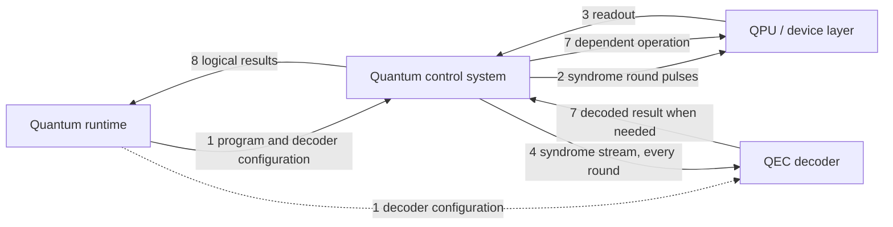
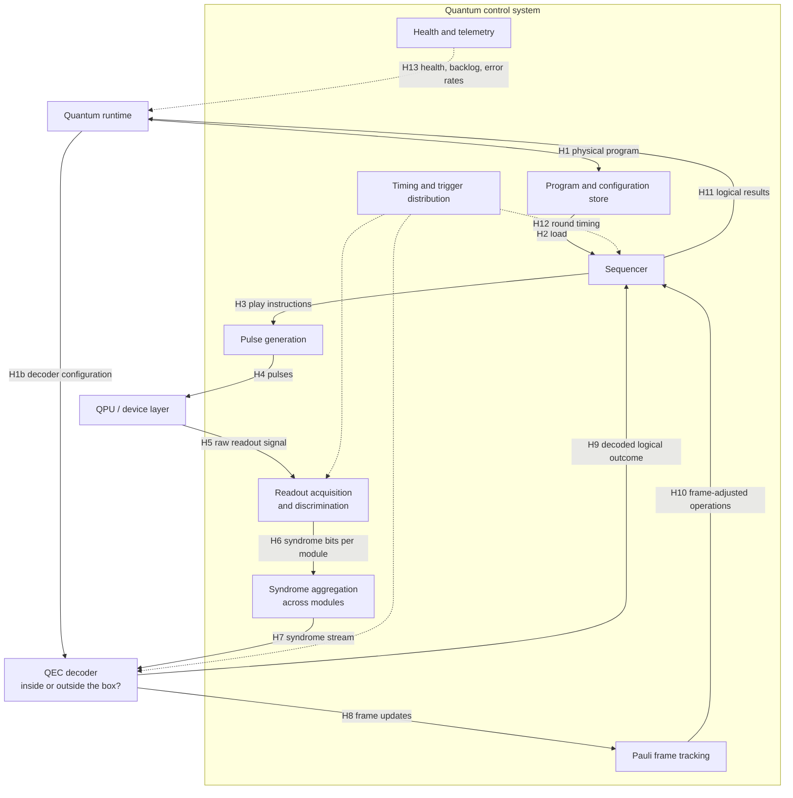

# UC-06 — QEC decoding and fast feedback

> **Seed draft.** The chair prepared this as a starting point for Meeting 03. Numbers are order-of-magnitude estimates to be confirmed or corrected by the owner and control expert. Every estimate is marked as such in its Source column.

| Field | Value |
|---|---|
| Status | Draft (seed for Meeting 03) |
| WG relevance | Primary |
| Timing regime | Hard real-time, streaming — term pending System Architecture WG alignment |
| Fault-tolerance assumption | Requires FTQC |
| Qubit modality | Modality-agnostic. Examples below use a surface code on superconducting qubits |
| Owner (Part A) | TBD (volunteer needed) |
| Control expert (Part B) | TBD |
| Reviewer | TBD |
| Last updated | 2026-10-20 |

---

# Part A — The scenario

## A1. Scenario

A fault-tolerant computer stores each logical qubit in many physical qubits. Over and over, many times per second, the control system measures helper qubits to check for errors. Each round produces a set of "syndrome" bits. These stream continuously to a decoder, which works out which errors most likely happened.

Most corrections don't need to be applied physically; the system just keeps track of them in software. But some logical operations (for example, the non-Clifford gates needed for universal computation) depend on the decoded result, so the decoder must deliver its answer before that operation can continue.

This runs for the whole computation, which may last hours.

## A2. Why it matters

- Error correction is the default assumption for this working group (Meeting 1), and decoding is where the hardest timing and bandwidth requirements come from.
- If the decoder can't keep up with the rate syndromes are produced, a backlog builds and the computation slows down or stalls.
- How quickly the decoder answers sets the logical clock speed of the whole machine.
- Whether the decoder sits inside the control system or outside it is still open from Meeting 1. This card makes the consequences concrete.

## A3. What this use case adds

- [x] A timing requirement no other use case has: sustained throughput plus a bounded reaction time, continuously for hours
- [x] A distinct data-movement pattern or data volume: a continuous high-rate syndrome stream
- [x] A distinct scheduling or co-allocation need: the decoder must be allocated with the QPU for the whole run, possibly on a co-scheduled node
- [x] A synchronization need across components: syndromes from many modules must be aligned by round before decoding
- [ ] An instruction-safety need
- [x] A scale need: data rate and program size grow with the number of qubits
- [x] An interface boundary the other use cases miss: control system ↔ decoder, which may be IF-G or internal

**Most distinctive:** a continuous stream that must be decoded at least as fast as it is produced, for the entire computation.

## A4. Scope checks

- [x] Runs on-premises
- [x] Any real-time feedback or decoding compute sits next to the QPU
- [x] If more than one QPU is involved, the control stack manages entanglement between them (single QPU; multi-QPU QEC belongs to UC-07)

## A5. Actors and logical components

| Logical role | Plain-language description | Involved? | What it does in this use case |
|---|---|---|---|
| Application | The user's program or algorithm | Yes | Expresses the logical circuit |
| Workflow / orchestration | Coordinates steps across CPU, GPU, and QPU tasks | No | — |
| HPC resource manager | Allocates classical nodes (e.g. Slurm) | ? | Only if the decoder runs on a co-scheduled HPC node |
| Quantum resource manager | Allocates and tracks QPU access | Yes | Reserves QPU and decoder together |
| Quantum runtime | Runs quantum programs and manages sessions | Yes | Loads the logical program and decoder configuration; collects logical results |
| Quantum control system | Electronics that turn programs into pulses and readout signals into data | Yes | Runs syndrome rounds and applies decoder-dependent operations |
| QPU / device layer | The qubits and their immediate hardware | Yes | — |
| Feedback compute | CPU, GPU, or FPGA processing results during execution | ? | May host the decoder (see C4) |
| QEC decoder | Turns error syndromes into corrections | Yes | Decodes the syndrome stream; returns corrections and logical outcomes |
| Other: compiler/toolchain | Lowers the logical program | Yes | Produces the physical program and decoding graph (candidate IF-K) |

## A6. Trigger and preconditions

**What starts it?** A fault-tolerant program begins, and syndrome extraction starts on all logical qubits.

**What must already be true?** QPU and decoder are allocated together. The device is calibrated, and the decoder is configured with the code layout and an error model derived from that calibration (a link to UC-04). The logical program is compiled to physical operations and loaded.

## A7. Nominal flow

1. The runtime loads the physical program and the decoder configuration (code layout, error weights).
2. The control system runs a syndrome-extraction round on the QPU.
3. The QPU returns readout for the helper qubits.
4. The control system turns readout into syndrome bits and streams them to the decoder.
5. The decoder updates its estimate of errors. Steps 2–5 repeat every round.
6. For most rounds, the decoder only updates a record of corrections kept in software (the "Pauli frame").
7. When a logical operation depends on a decoded result, the decoder sends the result to the control system, which then applies the right operation.
8. At the end, logical results return to the runtime.

## A8. Information flow, Level 1

## A9. How fast does it need to be?

- [x] Inside the same shot, while the qubits are still in use
- [ ] Between shots of the same program
- [ ] Between programs in the same session
- [ ] Between separate jobs, or later
- [ ] Not sure

**Rough deadline:** two different deadlines apply.
- **Throughput:** decode each round at least as fast as rounds are produced. About 1 µs per round for superconducting qubits; slower for ions and neutral atoms (estimate).
- **Reaction time:** from the last needed syndrome to the dependent operation. Roughly 1 µs–1 ms; around 10 µs is a commonly cited target for superconducting systems (estimate, to be confirmed).

**What sets that deadline?** The syndrome round time sets throughput. Reaction time sets the logical clock speed, and while waiting the system must keep running extra rounds.

---

# Part B — Inside the control stack

## B1. Information flow, Level 2

The decoder is drawn outside the box with the boundary hops marked "IF-G or internal", because its placement is undecided. A syndrome aggregation step is added: syndromes from many modules must be aligned by round before decoding.

## B2. Boundary crossings

| Hop | From → To | Interface | What crosses | Size × rate | Latency | Status | Source |
|---|---|---|---|---|---|---|---|
| H1 | Runtime → Program store | IF-E | Physical program for all logical qubits | Grows with qubit count; storage limits at thousands of qubits (Meeting 1, Daniel W.) | Not time-critical | TBD | |
| H1b | Runtime → Decoder | IF-G or internal; may involve IF-K | Code layout, decoding graph, error weights | MB-scale (estimate) | Not time-critical; updated after recalibration | TBD | Estimate (chair draft) |
| H2 | Program store → Sequencer | Internal | Program | — | Unknown | TBD | |
| H3 | Sequencer → Pulse generation | Internal | Play instructions | — | Unknown | TBD | |
| H4 | Pulse generation → QPU | IF-H (landscape only) | Pulses | — | — | TBD | |
| H5 | QPU → Readout acquisition | IF-H (landscape only) | Raw readout signal | — | Part of round time | TBD | |
| H6 | Readout → Aggregation | Internal | Syndrome bits, per module, tagged with round | ~1 bit per helper qubit per round | < 1 µs (superconducting) | TBD | Estimate (chair draft) |
| H7 | Aggregation → Decoder | **IF-G or internal** | Syndrome stream | ≈ (d² − 1) bits × logical qubits × rounds/s for a surface code. 1,000 physical qubits at 1 µs rounds ≈ 0.5 Gb/s. 100 logical qubits at d = 25 ≈ 60 Gb/s | Must sustain the rate; per-round latency counts toward L2 | TBD | Estimate (chair draft) |
| H8 | Decoder → Pauli frame | IF-G or internal | Correction updates | Small per round | Not deadline-bound until a dependent operation | TBD | |
| H9 | Decoder → Sequencer | **IF-G or internal** | Decoded logical outcome for a dependent operation | Bits | Part of reaction time (L2) | TBD | |
| H10 | Pauli frame → Sequencer | Internal | Frame-adjusted operations | Small | Unknown | TBD | |
| H11 | Sequencer → Runtime | IF-E | Logical results | Small | Not time-critical | TBD | |
| H12 | Timing distribution → modules and decoder | IF-J | Round boundaries, clock | — | — | TBD | |
| H13 | Telemetry → Runtime | IF-I | Health, decoder backlog, syndrome statistics, logical error rates | Small to moderate | > 1 s | TBD | |

## B3. Critical loops

| Loop | Hops | Deadline | What sets the deadline | Current estimate | Status |
|---|---|---|---|---|---|
| L1 Decoder throughput | H6 → H7 → decoder | Decode rate ≥ syndrome production rate, sustained | Round time | Unknown | Required |
| L2 Reaction time | H5 → H6 → H7 → decoder → H9 → H3 → H4 | Roughly 1 µs–1 ms (~10 µs target for superconducting) | Logical clock speed | Unknown | TBD |
| L3 Decoder reconfiguration | Recalibration → H1b | Before drift degrades decoding | Drift timescale | Unknown | TBD |

## B4. Requirements drivers

| Dimension | Draft requirement | Status | Evidence |
|---|---|---|---|
| Latency | Bounded reaction time for dependent logical operations (L2) | TBD | Needs vendor and literature input (C3) |
| Jitter | Bounded; variable decoding time must not cause a backlog | TBD | |
| Bandwidth / data volume | Sustained syndrome stream from ~0.1 to tens of Gb/s, depending on scale | TBD | Estimate (B2 H7) |
| Program size | Grows with qubit count; program storage is a limit at thousands of qubits | TBD | Meeting 1 (Daniel W.) |
| Synchronization | Syndromes from all modules aligned by round; decoder shares the round clock | TBD | |
| Determinism | Required for throughput; reaction time must be bounded | TBD | |
| Scale (qubits, QPUs, concurrent sessions) | Must scale with logical qubit count; decoding may be split across several decoder units | TBD | |
| Instruction safety | As for any program | TBD | |
| Failure behavior | Backlog or decoder failure must be detected and must stall or abort logical operations, never continue silently | TBD | |
| Observability / telemetry | Decoder backlog, syndrome statistics, logical error rates, data volume | TBD | Meeting 1 (Santiago) |

## B5. Interfaces exercised

| Interface | Boundary | Used? | Role in this use case |
|---|---|---|---|
| IF-A | Application ↔ Workflow/orchestration | No | — |
| IF-B | Workflow/orchestration ↔ HPC resource manager | No | — |
| IF-C | HPC resource manager ↔ Quantum resource manager | If decoder is on a co-scheduled node | Co-allocate decoder and QPU for the whole run |
| IF-D | Quantum resource manager ↔ Quantum runtime | Yes | Session |
| IF-E | Quantum runtime ↔ Control system | Yes | Physical program; logical results. Control flow and QEC information as one package at scale (Meeting 1, Daniel W.) |
| IF-F | Classical accelerator ↔ Quantum runtime | No | Not in the real-time loop |
| IF-G | Classical accelerator ↔ Control system | **Yes, if the decoder is outside the box** | Syndrome stream out, decoded results back |
| IF-H | Control system ↔ QPU/device layer | Landscape | — |
| IF-I | Telemetry/observability across layers | **Yes** | Backlog, error rates, data volume |
| IF-J | Time and synchronization across layers | **Yes** | Round alignment across modules and decoder |
| IF-K (candidate) | Compiler/toolchain ↔ runtime/control system | Yes | Lowering logical programs; producing the decoding graph |

## B6. Failure and edge cases

- **Backlog.** The decoder falls behind. The control system must stall dependent logical operations (and keep running syndrome rounds) until it catches up, or abort.
- **Decoder failure mid-run.** The logical state can no longer be trusted. Can the run recover, or must it restart?
- **Lost or out-of-order syndrome data.** A missing round from one module corrupts decoding. Detection and handling must be defined.
- **Drift.** The error model used by the decoder goes stale during a long run. When is it updated, and can it be updated without stopping?

---

# Part C — Open items

## C1. Questions for a control expert or vendor

| Question | Section | Asked to | Answer | Status |
|---|---|---|---|---|
| Where do decoders sit in today's systems: on the control box, on adjacent hardware, or on HPC nodes? | C4 | Control vendors, decoder developers | | Open |
| What link carries syndromes to an external decoder today, and what rate and latency does it achieve? | B2 H7 | Control vendors | | Open |
| What syndrome round times and reaction-time targets apply per modality? | A9 | Modality experts | | Open |
| How is decoder configuration produced and updated after calibration? | B2 H1b | Control vendors, decoder developers | | Open |
| How are syndromes from many modules aligned by round today? | B1 AGG | Control vendors | | Open |

## C2. Interoperability questions

- Is there a vendor-neutral format for the syndrome stream (bit layout, round and module tags)?
- Is there a vendor-neutral format for decoder configuration (code layout, error weights)?
- If decoders from one vendor are used with control systems from another, what must they agree on?

## C3. Evidence required

- Published decoder throughput and reaction-time measurements at relevant code distances.
- Syndrome data rates measured or projected for near-term and target system sizes.

## C4. Open decisions

| Decision | Options | Owner | Needed by |
|---|---|---|---|
| Is the decoder inside the control system or a separate role? (Carried from Meetings 1 and 2) | Inside (IF-G becomes internal) / separate (IF-G primary) / both as deployment options | Group | Meeting 03 |
| Does the WG characterize the syndrome stream format, or only its timing and rate? | Format and timing / timing and rate only | Group | Meeting 03 |
| Who owns this card? | Volunteer | Group | Meeting 03 |
